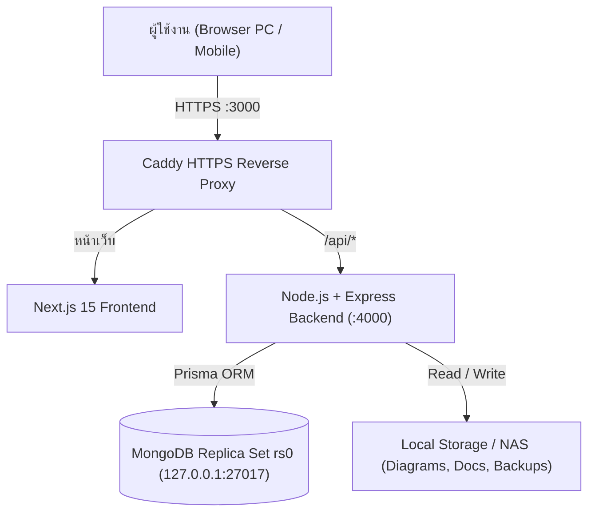
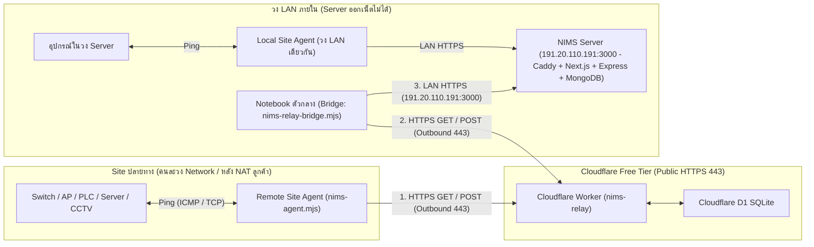
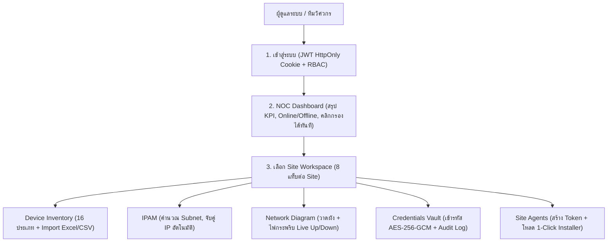
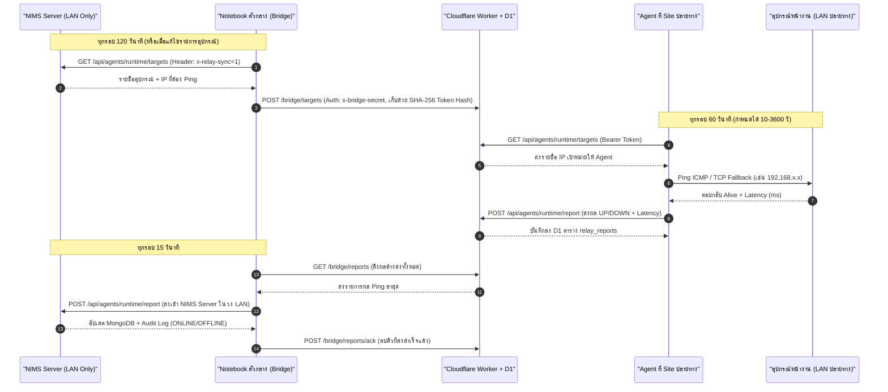
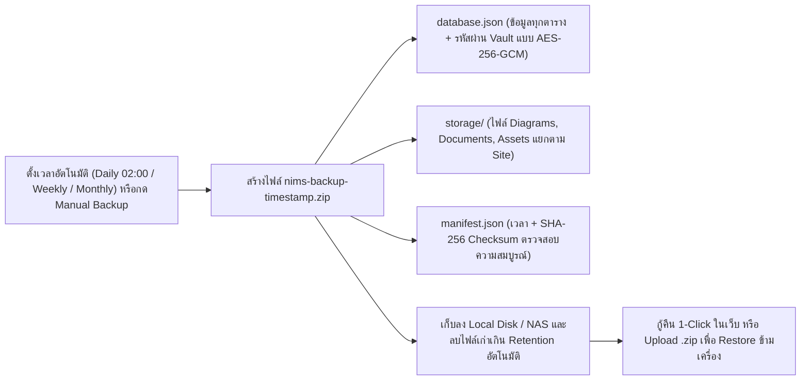

# NIMS – ภาพรวมระบบ, สถาปัตยกรรม, โครงสร้างเซิร์ฟเวอร์ และ Flow การทำงาน

**NIMS (Network Infrastructure Management System)** คือระบบบริหารจัดการโครงสร้างพื้นฐานเครือข่ายแบบรวมศูนย์ (On-Premise) ที่รวมการเก็บข้อมูลอุปกรณ์, IPAM, ผัง Network Diagram แบบโต้ตอบได้, ห้องนิรภัยรหัสผ่านแบบเข้ารหัส, เอกสารโครงการ และ **ระบบตรวจเช็กสถานะอุปกรณ์อัตโนมัติ (Site Ping Agents)** ทั้งในวง LAN เดียวกันและข้ามวง Network ไว้ในระบบเดียว

---

## 1. ปัญหาเดิม vs สิ่งที่ NIMS เข้ามาแก้ปัญหา

| ปัญหาเดิม (Before) | โซลูชันใน NIMS (After) |
| :--- | :--- |
| ข้อมูลอุปกรณ์และ IP กระจัดกระจายในไฟล์ Excel / รูปภาพ / PDF | รวมศูนย์ในฐานข้อมูลเดียว พร้อมตรวจสอบ IP/MAC ซ้ำอัตโนมัติ (IPAM + Inventory 16 ประเภท) |
| ผัง Network Diagram เป็นภาพนิ่ง ไม่รู้ว่าตัวไหนล่ม | ผัง **Interactive Network Diagram** ผูกกับ Inventory จริง แสดงไฟกระพริบ Up/Down และแสงวิ่งบนสายแบบเรียลไทม์ |
| Server กลางออกอินเทอร์เน็ตไม่ได้ และลูกค้าไม่อนุญาตให้เปิด Port Firewall | ใช้สถาปัตยกรรม **Outbound-Only Site Agent + Notebook Bridge + Cloudflare Relay** ไม่ต้องเปิด Port / Port Forward ที่ Router ลูกค้าเลย |
| การใช้รหัสผ่านร่วมกันไม่มีประวัติตรวจสอบ | **Credentials Vault** เข้ารหัส AES-256-GCM + **RBAC 5 ระดับ** + **Audit Log** บันทึกทุกการเข้าดูและคัดลอก |

---

## 2. เทคโนโลยีที่ใช้รันระบบ, เซิร์ฟเวอร์ และฐานข้อมูล (Runtime, Server & Database)

### 2.1 ระบบรันผ่านอะไร และใช้ Server ตัวไหน
ตัวระบบออกแบบให้ติดตั้งบน **Windows Server (On-Premise)** และทำงานผ่าน **Node.js Runtime** โดยตรง (รองรับการรันแบบไม่ต้องพึ่งอินเทอร์เน็ต และมี Docker Compose เป็นทางเลือกเสริม):

| ส่วนประกอบ (Component) | เทคโนโลยี / ซอฟต์แวร์ที่ใช้ | หน้าที่และพอร์ตการทำงาน |
| :--- | :--- | :--- |
| **HTTPS Reverse Proxy** | **Caddy Web Server** (`caddy_windows_amd64`) | รับการเชื่อมต่อ HTTPS หลักที่พอร์ต **`3000`** (`tls internal`) และกระจายทราฟฟิกไปยัง Frontend และ Backend API |
| **Web Frontend Server** | **Next.js 15** (React 19 + TypeScript + Tailwind CSS + React Flow) | ให้บริการหน้าเว็บ Portal, Dashboard, IPAM และ Network Diagram Editor (รันภายในหลัง Proxy) |
| **Backend API Server** | **Node.js + Express + TypeScript** | จัดการ REST API, Authentication, RBAC, AES-256-GCM Vault, Visio/Excel/PDF Engine และรับผลจาก Site Agents (พอร์ตภายใน **`4000`**) |
| **Process & Auto-Start** | **Windows Task Scheduler** (`NIMS Production Server`, `NIMS HTTPS Proxy`) + `scripts/run-nims.mjs` | สั่งเปิด Frontend, Backend และ Caddy อัตโนมัติตั้งแต่บูตเครื่อง Server |
| **Cloud Relay (สำหรับข้ามวง)** | **Cloudflare Workers** + **Cloudflare D1** | จุดพักรับ-ส่งผล Ping ผ่าน HTTPS 443 (เฉพาะเส้นทาง `/api/agents/runtime/*` และ `/bridge/*`) |
| **Bridge & Probe Agents** | **Node.js Standalone Scripts** (`nims-relay-bridge.mjs`, `nims-agent.mjs`) | รันเบื้องหลังอัตโนมัติผ่าน Windows Task Scheduler (`NIMS-Relay-Bridge`, `NIMS-SiteAgent-*`) |

### 2.2 ใช้ Database ยังไง และจัดเก็บข้อมูลอย่างไร
1. **ฐานข้อมูลหลัก (On-Premise Database):**
   - ใช้ **MongoDB Community Server** ตั้งค่าเป็น **Single-Node Replica Set (`rs0`)** ฟังเฉพาะภายในเครื่อง (`127.0.0.1:27017` — ปิดพอร์ตจากภายนอกด้วย Windows Firewall)
   - เชื่อมต่อผ่าน **Prisma ORM (`@prisma/client`)** จัดการโครงสร้าง Collection หลักครบวงจร เช่น `Sites`, `Devices` (16 ประเภท), `Subnets`, `IPAllocations`, `Diagrams` (เก็บประวัติเวอร์ชัน), `Documents`, `Credentials`, `MaintenanceRecords`, `SiteAgents`, `Users`, `Roles`, `UserSitePermissions` และ `AuditLogs`
   - **การป้องกันข้อมูลสำคัญ:** รหัสผ่านผู้ใช้ Hash ด้วย `bcrypt` และรหัสผ่านอุปกรณ์ใน Credentials Vault เข้ารหัสระดับ Field ด้วย **AES-256-GCM** (แยก Encryption Key ไว้ใน `.env` ของ Server)
2. **การจัดเก็บไฟล์และระบบสำรองข้อมูล (File Storage & Backup):**
   - ไฟล์ Diagram (`.png`, `.pdf`, `.vsdx`, `.drawio`) และเอกสารโครงการ เก็บแยกโฟลเดอร์ตาม `Site` บน Local Disk / NAS และเสิร์ฟผ่าน API ที่ตรวจสิทธิ์ RBAC ทุกครั้ง
   - รองรับ **Backup & Restore** แบบ ZIP Snapshot รวมทั้งข้อมูล MongoDB + ไฟล์อัปโหลดทั้งหมด + SHA-256 Manifest (กดสำรองเองหรือตั้งเวลาอัตโนมัติ)
3. **ฐานข้อมูลชั่วคราวบน Cloud (เฉพาะโหมด Cross-Network Relay):**
   - ใช้ **Cloudflare D1 (SQLite)** เก็บเฉพาะ 2 ตาราง คือ `relay_targets` (รายชื่อ IP เป้าหมาย) และ `relay_reports` (ผล Ping ล่าสุด)
   - อ้างอิงด้วยค่า **SHA-256 Hash ของ Agent Token** เท่านั้น (ไม่เก็บ Token จริง และลบทิ้งทันทีเมื่อ Bridge ดึงผลส่งเข้า MongoDB บน NIMS Server สำเร็จ)

---

## 3. สถาปัตยกรรมเครือข่าย (Network Topology Architecture)

ระบบรองรับการมอนิเตอร์อุปกรณ์ได้ 2 รูปแบบพร้อมกันบน Server เดียว:
1. **Same LAN Mode:** Site ที่อยู่ในวงเครือข่ายเดียวกับ NIMS Server (Agent ส่งผลเข้า Server ตรง)
2. **Cross-Network / Air-Gapped Mode:** Site อยู่คนละวง/คนละสาขา และ NIMS Server ออกเน็ตไม่ได้ (ใช้ Notebook ตัวกลาง + Cloudflare Workers & D1 เป็นสะพานส่งข้อมูลขาออกล้วน)

---

## 4. Flow การทำงานทั้งหมด (End-to-End Workflows)

### 4.1 การทำงานของระบบหลัก (Core Web Portal Flow)

### 4.2 Flow การทำงานของ Cross-Network Site Agent (คนละวงเน็ต & Server ไม่ออกเน็ต)

### 4.3 Flow การแสดงผลสถานะ Real-Time บนหน้าเว็บ
1. **ประมวลผลสถานะ (`evaluateDevicePingOutcome`):**
   - ถ้า Ping ผ่าน → อัปเดตอุปกรณ์เป็น `ONLINE`, รีเซ็ตจำนวนครั้งที่พลาด, บันทึก `lastLatencyMs` และ `lastPingAt`
   - ถ้า Ping ไม่ผ่าน → นับ `consecutiveMisses` เพิ่มขึ้นทีละ 1; เมื่อพลาดครบตามค่า `Offline Misses` (ค่าเริ่มต้น `3` ครั้ง) จึงเปลี่ยนสถานะเป็น `OFFLINE` พร้อมบันทึก `DEVICE_STATUS_TRANSITION` ลง Audit Log *(อุปกรณ์ที่ตั้ง `MAINTENANCE` ไว้จะไม่ถูกเขียนทับ)*
2. **การแสดงผลบนหน้าจอ (อัปเดตอัตโนมัติทุก 10 วินาที):**
   - **Sites / Device Inventory:** แสดงไฟ LED กระพริบสีเขียว (`ONLINE`) / สีแดง (`OFFLINE`) คู่กับค่า Ping (`ms`)
   - **Network Diagram:**
     - สาย **Link Cable** ที่เชื่อมอุปกรณ์ที่มี Agent จะมี **แสงวิ่ง + Halo เรืองกระพริบ** (เขียวเมื่อ `UP`, แดงกระพริบถี่เมื่อ `DOWN`)
     - ตัว **Node บนผัง** และ **Device / Node Inspector** แสดงไฟกระพริบ `UP • ONLINE` / `DOWN • OFFLINE` พร้อม Latency และเวลา Ping ล่าสุด

---

## 5. ระบบความปลอดภัย (Security Architecture)

1. **Zero Inbound Firewall Ports:** ทั้งเครื่อง Server, Notebook ตัวกลาง และเครื่อง Agent หน้างาน **ไม่ต้องเปิด Port ขาเข้าจากอินเทอร์เน็ต** และไม่ต้องขอแก้ไข Router ของลูกค้า
2. **Token & Secret Isolation:**
   - Agent Token (`nims_agt_...`) เก็บเฉพาะ **SHA-256 Hash** ทั้งใน MongoDB และบน Cloudflare D1 (ไม่เก็บ Token ดิบไว้บน Cloud)
   - ช่องทางควบคุม Bridge (`/bridge/*`) แยกสิทธิ์ด้วย `BRIDGE_SECRET` แบบ Constant-Time Comparison
   - หน้าเว็บหลัก/Login/ฐานข้อมูลของ NIMS **ไม่ถูกเปิดออกอินเทอร์เน็ต** — มีเฉพาะข้อมูล Target IP และผล Ping ที่วิ่งผ่าน Cloud Relay
3. **Data Protection:** รหัสผ่านผู้ใช้ Hash ด้วย `bcrypt`, ข้อมูลใน Credentials Vault เข้ารหัสด้วย **AES-256-GCM**, Session ใช้ **HttpOnly Cookie + CSRF**, และตรวจสิทธิ์ **RBAC ราย Site** ทุก API

### 5.1 ตารางควบคุมสิทธิ์ผู้ใช้งาน 5 ระดับ (RBAC Permission Matrix)

| Role | ขอบเขต Site | ดู Inventory / Diagram / IPAM | แก้ไข / ลบข้อมูล | เข้าดู Credentials Vault | จัดการผู้ใช้ / Backup |
| :--- | :--- | :---: | :---: | :---: | :---: |
| **`SUPER_ADMIN`** | ทุก Site ทั้งองค์กร | ✅ | ✅ | ✅ *(บันทึก Audit Log)* | ✅ |
| **`SITE_ADMIN`** | เฉพาะ Site ที่ได้รับสิทธิ์ | ✅ | ✅ *(ตาม Flag)* | ✅ *(ตาม Flag + Audit Log)* | จัดการ Site ที่ได้รับสิทธิ์ |
| **`NETWORK_ENGINEER`** | เฉพาะ Site ที่ได้รับสิทธิ์ | ✅ | ✅ *(ตาม Flag)* | ✅ *(ตาม Flag + Audit Log)* | ❌ |
| **`VIEWER`** | เฉพาะ Site ที่ได้รับสิทธิ์ | ✅ *(ดูอย่างเดียว)* | ❌ *(บล็อกระดับ API)* | ✅ *(เฉพาะถ้าเปิด Flag ให้)* | ❌ |
| **`IP_VIEWER`** | เฉพาะ Site ที่ได้รับสิทธิ์ | ✅ *(ดูอย่างเดียว)* | ❌ *(บล็อกระดับ API)* | 🚫 **บล็อก 100% (`403`)** | ❌ |

---

## 6. ความสามารถในการรองรับ (Capacity & Scalability)

### 6.1 Site ในวง LAN / VPN เดียวกัน (Direct LAN Mode)
- **ไม่จำกัดจำนวนด้วยโควตา Cloud** (ขึ้นกับสเปกเครื่อง NIMS Server และ MongoDB)
- API `POST /api/agents/runtime/report` รองรับสูงสุด **`5,000` อุปกรณ์ต่อรอบรายงาน** และอัปเดตฐานข้อมูลแบบ Batch
- **รองรับได้ ~100+ Sites** (หลายพันอุปกรณ์) บน Server มาตรฐาน

### 6.2 Site คนละวง Network (Cross-Network ผ่าน Cloudflare Workers + D1 แพ็กเกจ Free)

Cloudflare แพ็กเกจ **Free (0 บาท/เดือน)** ให้โควตา:
- **Cloudflare Workers:** `100,000` Requests / วัน
- **Cloudflare D1 (SQLite):** `100,000` Rows Written / วัน และ `5,000,000` Rows Read / วัน

> เหตุผลที่ระบบใช้ **Cloudflare D1** แทน KV: เพราะ Workers KV Free เขียนได้แค่วันละ `1,000` ครั้ง (ใช้ได้ไม่ถึง 1 Site) แต่ **D1 Free เขียนได้ถึงวันละ `100,000` แถว** และระบบ Sync รายชื่ออุปกรณ์เฉพาะตอนมีการเปลี่ยนแปลง

#### ตารางประเมินจำนวน Site ที่รองรับได้ (Cloudflare Free Tier)

| รอบการ Ping ของแต่ละ Site (`Poll Interval`) | รอบดึงผลของ Bridge (`BRIDGE_POLL_SEC`) | ปริมาณ Request ต่อ 1 Site / วัน | **จำนวน Remote Sites ที่รองรับได้ (Free Tier)** | หมายเหตุการใช้งาน |
| :---: | :---: | :---: | :---: | :--- |
| **ทุก 60 วินาที** *(ค่าเริ่มต้น)* | 15 วินาที | ~4,320 req/วัน *(+5,760 req คงที่จาก Bridge)* | **~15 – 20 Sites** | แนะนำสำหรับใช้งานทั่วไป ปลอดภัยไม่ชนเพดาน 100k req/วัน |
| **ทุก 120 วินาที** *(2 นาที)* | 30 วินาที | ~2,160 req/วัน *(+2,880 req คงที่จาก Bridge)* | **~40 – 45 Sites** | เหมาะเมื่อมีสาขาเยอะขึ้นและรับดีเลย์ 2 นาทีได้ |
| **ทุก 300 วินาที** *(5 นาที)* | 60 วินาที | ~864 req/วัน *(+1,440 req คงที่จาก Bridge)* | **~100+ Sites** | สำหรับเน้นเฝ้าระวังระดับสาขาจำนวนมาก |

> **กรณีขยายเกิน 100 Sites หรือต้องการ Ping ถี่ทุก 10–30 วินาที:**
> - อัปเกรด Cloudflare Workers เป็นแพ็กเกจ **Paid (\$5/เดือน ≈ 170 บาท)** จะได้ **10,000,000 Requests/เดือน** + D1 **50,000,000 Rows Written/เดือน** → ขยายรองรับได้ **หลายร้อย Sites** ทันทีโดยไม่ต้องแก้โค้ดระบบเลยครับ

---

## 7. งบประมาณและทรัพยากรที่ต้องใช้ (Cost & Resource Summary)

| รายการ | ซอฟต์แวร์ / บริการที่ใช้ | ค่าใช้จ่าย |
| :--- | :--- | :---: |
| **Web Portal & API Server** | Node.js + Next.js + Express + Caddy (On-Premise) | **0 บาท** *(Open Source)* |
| **ฐานข้อมูลหลัก** | MongoDB Community Server + Prisma ORM | **0 บาท** *(ใช้เครื่อง Server เดิมได้)* |
| **Cloud Relay (สำหรับข้ามวงเน็ต)** | Cloudflare Workers + D1 Free Tier | **0 บาท/เดือน** *(รองรับ ~15–45+ Sites)* |
| **เครื่องกลาง (Bridge) & หน้างาน** | ใช้ PC / Notebook / Mini-PC ที่มีอยู่แล้ว | **0 บาท** *(ไม่บังคับซื้ออุปกรณ์ใหม่)* |
| **VPN / Public IP รายสาขา** | ไม่จำเป็นต้องใช้ (ทำงานผ่าน Outbound HTTPS 443) | **ประหยัด 100%** |

---

## 8. การรับมือเมื่อเกิดเหตุขัดข้อง (Resilience & Failure Handling)

| สถานการณ์ที่อาจเกิดขึ้น | กลไกการทำงานของระบบ | ผลกระทบต่อผู้ดูแล |
| :--- | :--- | :--- |
| **Server หรือ Notebook รีสตาร์ท / ไฟดับ** | Windows Task Scheduler (`NIMS Production Server`, `NIMS HTTPS Proxy`, `NIMS-Relay-Bridge`, `NIMS-SiteAgent-*`) เปิดบริการกลับเองอัตโนมัติ | **ไม่ต้องเข้าไปเปิดโปรแกรมเอง** |
| **อินเทอร์เน็ตหลุดชั่วคราว** | Agent หน้างานยังคงวนทำงานและ Retry อัตโนมัติ, ข้อมูลค้างใน D1 จะยังไม่ถูกลบจนกว่า Bridge จะส่งถึง Server สำเร็จ (`ACK` หลัง HTTP 200) | **ไม่ต้องเดินทางไปหน้างาน**, ข้อมูลไม่สูญหาย |
| **อุปกรณ์หน่วง / Ping หลุด 1–2 ครั้ง** | ระบบใช้ค่า `Offline Misses` (ค่าเริ่มต้น `3` ครั้งติดกัน) ก่อนเปลี่ยนเป็น `OFFLINE` และคงสถานะ `MAINTENANCE` ไว้ไม่เขียนทับ | **ลด Alert หลอก (False Alarm)** |
| **ตรวจสอบโควตาและการทำงาน** | ดูกราฟ `Requests today` / `Rows written` ได้จาก Cloudflare Dashboard และดู Log การเปลี่ยนสถานะทั้งหมดใน Audit Logs | **ติดตามและวางแผนขยายระบบได้ล่วงหน้า** |

---

## 9. ระบบสำรองและกู้คืนข้อมูล (Backup & Restore)

ระบบมีกลไก **Backup & Restore ในตัว** (ควบคุมผ่านเมนู **System & Backup** สำหรับ `SUPER_ADMIN` เท่านั้น) เพื่อป้องกันข้อมูลสูญหายและรองรับการย้ายเครื่อง Server ได้ทันที:

- **สิ่งที่รวมอยู่ในไฟล์ Backup (`.zip`):**
  1. `database.json` — Snapshot ข้อมูลทั้งหมดในระบบ (Sites, Devices, IPAM, Credentials ที่ยังเข้ารหัส **AES-256-GCM**, Diagrams, Documents, Maintenance, Users, RBAC, Settings)
  2. `storage/` — ไฟล์ผังเครือข่ายและเอกสารโครงการทั้งหมดแยกตาม Site
  3. `manifest.json` — ข้อมูลเวลาและ **SHA-256 Checksum** สำหรับตรวจสอบความถูกต้องก่อนกู้คืน
- **การตั้งเวลาและการเก็บไฟล์ (Retention):** ตั้งความถี่ได้ทั้ง `Daily (02:00 AM)`, `Weekly`, `Monthly` หรือ `Manual Only` พร้อมกำหนดจำนวนชุด Backup ที่เก็บย้อนหลังอัตโนมัติ (ระบุปลายทางเป็น Local Disk หรือ Mounted NAS ได้)
- **การกู้คืน (Restore):** กด **Restore** จากรายการย้อนหลัง หรือ **Upload & Restore (`.zip`)** ได้จากหน้าเว็บโดยตรง *(รองรับ `mongodump` / `mongorestore` เพิ่มเติมสำหรับฐานข้อมูลขนาดใหญ่ และต้องสำรองค่า `CREDENTIALS_ENCRYPTION_KEY` ใน `.env` แยกไว้อย่างปลอดภัยเพื่อให้ถอดรหัส Vault ได้หลังย้ายเครื่อง)*

---

## 10. แผนพัฒนาต่อยอดในอนาคต (Future Roadmap)

- **การแจ้งเตือนอัตโนมัติ (Alerting & Notifications):** ส่งแจ้งเตือนไปยัง **Email / Microsoft Teams / LINE / Webhook** ทันทีเมื่ออุปกรณ์หลักเปลี่ยนสถานะเป็น `OFFLINE`
- **รายงานความพร้อมใช้งาน (Uptime & SLA Reports):** สรุปสถิติ % Uptime, ค่า Latency เฉลี่ย และประวัติ Down-time รายเดือนแยกตาม Site
- **การตรวจวัดเชิงลึก (Extended Telemetry):** ต่อยอด Agent ให้ตรวจสอบ **TCP Service / HTTP Endpoint / SNMP** (CPU, Memory, Port Traffic) เพิ่มเติมจาก ICMP Ping

---

## 11. สรุปจุดเด่นและคุณค่าของระบบ (Key Takeaways & Business Value)

1. **ประหยัดงบประมาณและลดเวลาติดตั้ง:** ใช้โครงสร้างที่มีอยู่ (On-Premise Server + Cloudflare Free Tier 0 บาท) ไม่ต้องซื้อ IP Public หรือเช่า VPN Tunnel รายสาขา
2. **ปลอดภัยและไม่กระทบระบบเครือข่ายลูกค้า (Zero Router Config):** ไม่ต้องขอเปิด Port ขาเข้าหรือแก้ Firewall/Router ของลูกค้าทั้งฝั่งต้นทางและปลายทาง
3. **ติดตั้งและขยายสาขาได้แบบ 1-Click:** สร้าง Agent บนหน้าเว็บ → ดาวน์โหลดไฟล์ `.bat` ไปดับเบิลคลิกที่เครื่องกลางและเครื่องปลายทาง → ติดตั้ง Runtime, Auto-Start และรันเบื้องหลังอัตโนมัติ
4. **ติดตามปัญหาเชิงรุกแบบ Real-Time:** คลิกเจาะลึกจาก NOC Dashboard ไปยังอุปกรณ์ที่มีปัญหาได้ทันที และเห็นไฟกระพริบแจ้งเตือน Up/Down บนผัง Network Diagram แบบเรียลไทม์
5. **รองรับการเติบโตในอนาคต (Scalable):** รองรับทั้งวง LAN (`100+` Sites) และ Remote ข้ามวง (`15–45+` Sites ฟรี, ขยายได้เป็นหลักร้อย Sites ด้วยงบเพียง ~\$5/เดือน)
