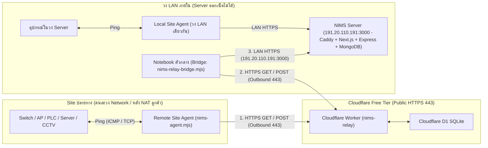
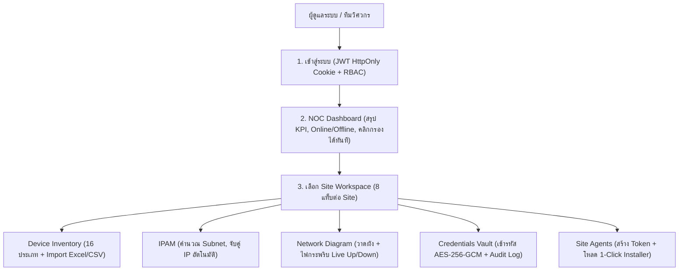

# NIMS – ภาพรวมระบบ, สถาปัตยกรรม และ Flow การทำงานทั้งหมด (เอกสารสำหรับนำเสนอ)

**NIMS (Network Infrastructure Management System)** คือระบบบริหารจัดการโครงสร้างพื้นฐานเครือข่ายแบบรวมศูนย์ (On-Premise) ที่รวมการเก็บข้อมูลอุปกรณ์, IPAM, ผัง Network Diagram แบบโต้ตอบได้, ห้องนิรภัยรหัสผ่านเข้ารหัส, เอกสารโครงการ และ **ระบบตรวจเช็กสถานะอุปกรณ์อัตโนมัติ (Site Ping Agents)** ทั้งในวง LAN เดียวกันและข้ามวง Network ไว้ในจุดเดียว

---

## 1. ปัญหาเดิม vs สิ่งที่ NIMS เข้ามาแก้ปัญหา

| ปัญหาเดิม (Before) | โซลูชันใน NIMS (After) |
| :--- | :--- |
| ข้อมูลอุปกรณ์และ IP กระจัดกระจายในไฟล์ Excel / รูปภาพ / PDF | รวมศูนย์ในฐานข้อมูลเดียว พร้อมตรวจสอบ IP/MAC ซ้ำอัตโนมัติ (IPAM + Inventory 16 ประเภท) |
| ผัง Network Diagram เป็นภาพนิ่ง ไม่รู้ว่าตัวไหนล่ม | ผัง **Interactive Network Diagram** ผูกกับ Inventory จริง แสดงไฟกระพริบ Up/Down และแสงวิ่งบนสายแบบเรียลไทม์ |
| Server กลางออกอินเทอร์เน็ตไม่ได้ และลูกค้าไม่อนุญาตให้เปิด Port Firewall | ใช้สถาปัตยกรรม **Outbound-Only Site Agent + Notebook Bridge + Cloudflare Relay** ไม่ต้องเปิด Port / Port Forward ที่ Router ลูกค้าเลย |
| การใช้รหัสผ่านร่วมกันไม่มีประวัติตรวจสอบ | **Credentials Vault** เข้ารหัส AES-256-GCM + **RBAC 5 ระดับ** + **Audit Log** บันทึกทุกการเข้าดูและคัดลอก |

---

## 2. สถาปัตยกรรมภาพรวม (System Architecture & Network Topology)

ระบบรองรับการมอนิเตอร์อุปกรณ์ได้ 2 รูปแบบพร้อมกันบน Server เดียว:
1. **Same LAN Mode:** Site ที่อยู่ในวงเครือข่ายเดียวกับ NIMS Server (Agent ส่งผลเข้า Server ตรง)
2. **Cross-Network / Air-Gapped Mode:** Site อยู่คนละวง/คนละสาขา และ NIMS Server ออกเน็ตไม่ได้ (ใช้ Notebook ตัวกลาง + Cloudflare Workers & D1 เป็นสะพานส่งข้อมูลขาออกล้วน)

---

## 3. Flow การทำงานทั้งหมด (End-to-End Workflows)

### 3.1 การทำงานของระบบหลัก (Core Web Portal Flow)

### 3.2 Flow การทำงานของ Cross-Network Site Agent (คนละวงเน็ต & Server ไม่ออกเน็ต)

### 3.3 Flow การแสดงผลสถานะ Real-Time บนหน้าเว็บ
1. **ประมวลผลสถานะ (`evaluateDevicePingOutcome`):**
   - ถ้า Ping ผ่าน → อัปเดตอุปกรณ์เป็น `ONLINE`, รีเซ็ตจำนวนครั้งที่พลาด, บันทึก `lastLatencyMs` และ `lastPingAt`
   - ถ้า Ping ไม่ผ่าน → นับ `consecutiveMisses` เพิ่มขึ้นทีละ 1; เมื่อพลาดครบตามค่า `Offline Misses` (ค่าเริ่มต้น `3` ครั้ง) จึงเปลี่ยนสถานะเป็น `OFFLINE` พร้อมบันทึก `DEVICE_STATUS_TRANSITION` ลง Audit Log *(อุปกรณ์ที่ตั้ง `MAINTENANCE` ไว้จะไม่ถูกเขียนทับ)*
2. **การแสดงผลบนหน้าจอ (อัปเดตอัตโนมัติทุก 10 วินาที):**
   - **Sites / Device Inventory:** แสดงไฟ LED กระพริบสีเขียว (`ONLINE`) / สีแดง (`OFFLINE`) คู่กับค่า Ping (`ms`)
   - **Network Diagram:**
     - สาย **Link Cable** ที่เชื่อมอุปกรณ์ที่มี Agent จะมี **แสงวิ่ง + Halo เรืองกระพริบ** (เขียวเมื่อ `UP`, แดงกระพริบถี่เมื่อ `DOWN`)
     - ตัว **Node บนผัง** และ **Device / Node Inspector** แสดงไฟกระพริบ `UP • ONLINE` / `DOWN • OFFLINE` พร้อม Latency และเวลา Ping ล่าสุด

---

## 4. ระบบความปลอดภัย (Security Architecture)

1. **Zero Inbound Firewall Ports:** ทั้งเครื่อง Server, Notebook ตัวกลาง และเครื่อง Agent หน้างาน **ไม่ต้องเปิด Port ขาเข้าจากอินเทอร์เน็ต** และไม่ต้องขอแก้ไข Router ของลูกค้า
2. **Token & Secret Isolation:**
   - Agent Token (`nims_agt_...`) เก็บเฉพาะ **SHA-256 Hash** ทั้งใน NIMS Database และบน Cloudflare D1 (ไม่เก็บ Token ดิบไว้บน Cloud)
   - ช่องทางควบคุม Bridge (`/bridge/*`) แยกสิทธิ์ด้วย `BRIDGE_SECRET` แบบ Constant-Time Comparison
   - หน้าเว็บหลัก/Login/Database ของ NIMS **ไม่ถูกเปิดออกอินเทอร์เน็ต** — มีเฉพาะข้อมูล Target IP และผล Ping ที่วิ่งผ่าน Cloud Relay
3. **Data Protection:** รหัสผ่านผู้ใช้ Hash ด้วย `bcrypt`, ข้อมูลใน Credentials Vault เข้ารหัสด้วย **AES-256-GCM**, Session ใช้ **HttpOnly Cookie + CSRF**, และตรวจสิทธิ์ **RBAC ราย Site** ทุก API

---

## 5. ความสามารถในการรองรับ (Capacity & Scalability)

### 5.1 Site ในวง LAN / VPN เดียวกัน (Direct LAN Mode)
- **ไม่จำกัดจำนวนด้วยโควตา Cloud** (ขึ้นกับสเปกเครื่อง NIMS Server และ MongoDB)
- API `POST /api/agents/runtime/report` รองรับสูงสุด **`5,000` อุปกรณ์ต่อรอบรายงาน** และอัปเดตฐานข้อมูลแบบ Batch
- **รองรับได้ ~100+ Sites** (หลายพันอุปกรณ์) บน Server มาตรฐาน

### 5.2 Site คนละวง Network (Cross-Network ผ่าน Cloudflare Workers + D1 แพ็กเกจ Free)

Cloudflare แพ็กเกจ **Free (0 บาท/เดือน)** ให้โควตา:
- **Cloudflare Workers:** `100,000` Requests / วัน
- **Cloudflare D1 (SQLite):** `100,000` Rows Written / วัน และ `5,000,000` Rows Read / วัน

> เหตุผลที่ระบบใช้ **Cloudflare D1** แทน KV: เพราะ Workers KV Free เขียนได้แค่วันละ `1,000` ครั้ง (ใช้ได้ไม่ถึง 1 Site) แต่ **D1 Free เขียนได้ถึงวันละ `100,000` แถว** และระบบ Sync รายชื่ออุปกรณ์เฉพาะตอนมีการเปลี่ยนแปลง

#### ตารางประเมินจำนวน Site ที่รองรับได้ (Cloudflare Free Tier)

| รอบการ Ping ของแต่ละ Site (`Poll Interval`) | รอบดึงผลของ Bridge (`BRIDGE_POLL_SEC`) | ปริมาณ Request ต่อ 1 Site / วัน | **จำนวน Remote Sites ที่รองรับได้ (Free Tier)** | หมายเหตุการใช้งาน |
| :---: | :---: | :---: | :---: | :--- |
| **ทุก 60 วินาที** *(ค่าเริ่มต้น)* | 15 วินาที | ~4,320 req/วัน *(+5,760 req คงที่จาก Bridge)* | **~15 – 20 Sites** | แนะนำสำหรับใช้งานทั่วไป ปลอดภัยไม่ชนเพดาน 100k req/วัน |
| **ทุก 120 วินาที** *(2 นาที)* | 30 วินาที | ~2,160 req/วัน *(+2,880 req คงที่จาก Bridge)* | **~40 – 45 Sites** | เหมาะเมื่อมีสาขาเยอะขึ้นและรับดีเลย์ 2 นาทีได้ |
| **ทุก 300 วินาที** *(5 นาที)* | 60 วินาที | ~864 req/วัน *(+1,440 req คงที่จาก Bridge)* | **~100+ Sites** | สำหรับเน้นเฝ้าระวังระดับสาขาจำนวนมาก |

> **กรณีขยายเกิน 100 Sites หรือต้องการ Ping ถี่ทุก 10–30 วินาที:**
> - อัปเกรด Cloudflare Workers เป็นแพ็กเกจ **Paid (\$5/เดือน ≈ 170 บาท)** จะได้ **10,000,000 Requests/เดือน** + D1 **50,000,000 Rows Written/เดือน** → ขยายรองรับได้ **หลายร้อย Sites** ทันทีโดยไม่ต้องแก้โค้ดระบบเลยครับ

---

## 6. สรุปประเด็นสำคัญสำหรับใช้ Present หัวหน้า (Key Takeaways)

1. **ประหยัดและติดตั้งเร็ว:** ใช้ทรัพยากรที่มีอยู่ (On-Premise Server + Cloudflare Free Tier 0 บาท) ไม่ต้องซื้อ IP Public หรือเช่า VPN Tunnel รายสาขา
2. **ไม่กระทบระบบลูกค้า (Zero Router Config):** ไม่ต้องขอเปิด Port หรือตั้ง Firewall ขาเข้าที่ Router ลูกค้า
3. **ติดตั้งง่ายแบบ 1-Click:** สร้าง Agent บนหน้าเว็บ → กดโหลด `.bat` ตัวเดียวไปดับเบิลคลิกที่เครื่องกลางและเครื่องปลายทาง → ติดตั้ง Node.js, Auto-Start และรันเบื้องหลังให้อัตโนมัติ
4. **เห็นภาพรวมทันทีแบบ Real-Time:** คลิกจาก Dashboard เพื่อเจาะดูเครื่องที่มีปัญหาได้เลย และเห็นสาย/อุปกรณ์กระพริบแจ้งเตือน Up/Down บนผัง Network Diagram ทันที
5. **รองรับการขยายตัวในอนาคต:** รองรับทั้งวง LAN (`100+` Sites) และ Remote ข้ามวง (`15–45+` Sites ฟรี, ขยายได้เป็นหลักร้อย Sites ด้วยงบเพียง ~\$5/เดือน)
